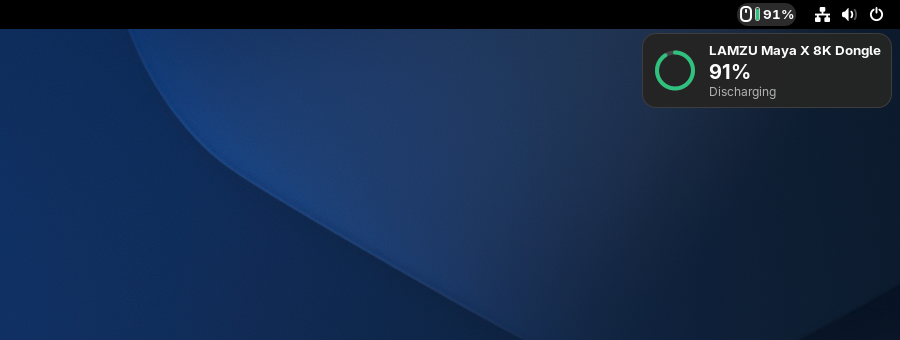

<h1 align="center">
  
  &nbsp;Ampere
</h1>

<p align="center">
  Battery level of wireless mice and keyboards in the GNOME top bar. Clean, configurable and out of your way.
</p>

<p align="center">
  <a href="https://extensions.gnome.org/extension/11770/ampere/"></a>
  <a href="https://github.com/crian/ampere/stargazers"></a>
  
  <a href="https://github.com/crian/ampere/actions/workflows/ci.yml"></a>
  <a href="LICENSE"></a>
</p>

<p align="center">
  
</p>

## About

Ampere shows the battery level of your wireless peripherals right in the GNOME top bar. Devices reported by UPower work out of the box, with automatic deduplication when a mouse is connected by both cable and receiver.

Mice that only expose their battery through vendor HID reports (Lamzu, MCHOSE, ATK/Compx) are supported through an optional companion service (`ampere-hid`) that the extension talks to over D-Bus. The extension itself never spawns processes or downloads anything.

## Features

Everything you need to keep an eye on your wireless gear, and nothing you do not.

&nbsp;✓&nbsp; **Clean panel indicator**: toggle icon, vertical battery bar and percentage independently.<br>
&nbsp;✓&nbsp; **Placement choice**: own top-bar button next to Quick Settings (click it to open the preferences), or between the other system icons.<br>
&nbsp;✓&nbsp; **Hover card**: battery ring, device name, percentage and charging state on hover — with native **Blur my Shell** (v78+) support.<br>
&nbsp;✓&nbsp; **Custom colors and thresholds**: Adwaita defaults for high, medium, low and charging states, or monochrome mode, with one-click reset.<br>
&nbsp;✓&nbsp; **Low-battery notifications**: optional alert once per discharge cycle when a device drops to the low threshold.<br>
&nbsp;✓&nbsp; **Per-device controls**: hide individual devices or give cryptic receivers friendly custom names.<br>
&nbsp;✓&nbsp; **UPower + vendor HID**: works out of the box for UPower peripherals, plus optional D-Bus support for Lamzu, MCHOSE and ATK/Compx mice.

## Installation

The easiest way to install Ampere is straight from the GNOME Extensions website.

<p align="center">
  <a href="https://extensions.gnome.org/extension/11770/ampere/"></a>
</p>

<details>
<summary><strong>Build and install from source</strong></summary>

```sh
git clone https://github.com/crian/ampere.git
cd ampere
make install
```

`make install` compiles the schema, packs the extension from `extension/` and installs it with `gnome-extensions`. Run `make help` to see all targets (including `make dev` for symlinked development).

Log out and back in afterwards; Wayland cannot reload the shell in place.

</details>

## Vendor HID devices (optional)

This section is only needed for mice that are not reported by UPower, such as a Lamzu Maya X, an MCHOSE A7 V2 Pro or an ATK A9. Everything else works without it.

Download the single-file `ampere-hid` service from the [latest release](https://github.com/crian/ampere/releases/latest) and run its installer:

```sh
curl -fsSLo ampere-hid \
  https://github.com/crian/ampere/releases/latest/download/ampere-hid
chmod +x ampere-hid
./ampere-hid install --udev
```

Then enable **Show vendor HID battery** in the extension preferences. If the service is not running, the preferences show the install command again.

To check the download, fetch `ampere-hid.sha256` from the same release and run `sha256sum -c ampere-hid.sha256` next to the file. That catches a broken or truncated download; it does not prove that the release itself is genuine.

<details>
<summary><strong>How the service works, uninstalling and NixOS / non-systemd notes</strong></summary>

- `install` copies `ampere-hid` to `~/.local/bin/ampere-hid` and writes a systemd user unit and a D-Bus activation file. The unit is not enabled at login: D-Bus starts it on demand when the extension asks, and it exits after five minutes without requests (`AMPERE_HID_IDLE_EXIT`, `0` disables).
- `--udev` installs the udev rule granting your user access to the supported HID product IDs (requires root via `sudo` or `pkexec`, one-time step). Without the flag, `install` prompts when the rule is missing or outdated; `--no-udev` skips the prompt. To test an unlisted model locally, place a separate rule in `/etc/udev/rules.d/`, as the generated file is overwritten on update.
- From a git checkout, use `make daemon-install` (add `UDEV=1` for the udev rule) to build and install the same single file.
- To remove everything again:

  ```sh
  ampere-hid uninstall          # add --udev to remove the udev rule as well
  ```

- **NixOS:** add the output of `ampere-hid rules` to `services.udev.extraRules`; packaging the service itself (for example via a home-manager module) is out of scope here.
- **Without systemd:** `install` still writes the files but starts nothing — launch `ampere-hid run` from your session startup instead.

</details>

### Supported devices

| Device | Transport | Verified |
| --- | --- | --- |
| Lamzu Maya X 8K (`373e:001e`, `001c`) | Aurora 65-byte feature report | yes |
| Lamzu Thorn (`3554:f50d`, on the cable `3554:f50f`) | Compx 17-byte report | yes |
| Other Lamzu receivers (`3554`, `37b0`) | Aurora and Compx, whichever answers | not tested |
| ATK A9 Max Ultra 2.0 (`373b:11fe`, on the cable `373b:1270`) | Compx 17-byte report | yes |
| Other ATK/VXE/VGN and Compx rebrands (`373b`, `260d`, `33e4`) | Compx | not tested |
| MCHOSE A7 V2 Pro (`3837:100a`, on the cable `3837:4018`) | MCHOSE feature query | yes |
| Other MCHOSE receivers (`3837`, `5253`) | MCHOSE feature query | not tested |

Only rows marked **yes** were verified on real hardware. If your model is missing, check whether its product ID appears in `ampere-hid rules`; if not, the VID:PID from `lsusb` needs to be added (see [CONTRIBUTING.md](CONTRIBUTING.md)).

<details>
<summary><strong>Troubleshooting: if a mouse is not recognized</strong></summary>

1. **What does the service see?**

   ```sh
   ampere-hid status
   ```

   Shows version, service state, whether the udev rule matches this version and the devices returned. `"inactive"` is normal: D-Bus starts the service on demand.

2. **What does the device answer?**

   ```sh
   ampere-hid diagnose
   ```

   Lists every hidraw device with its driver and raw answer. It only sends read-only battery queries and changes no settings. A sleeping mouse answers nothing — move it and try again. A node it cannot open carries a `reason` (missing rule or unlisted product ID).

3. **Is the product ID in the rule?**

   ```sh
   lsusb -d <vendor>:
   ampere-hid rules | grep -i idProduct
   ```

   If `lsusb` shows a product ID that the rule does not list, add it (see [CONTRIBUTING.md](CONTRIBUTING.md)) or open an issue with that line.

If all of that looks right and the panel stays empty, open an issue with the output of both commands and the model name.

- Devices reported by UPower do not need the service at all (`upower -e`).
- A mouse connected by cable and receiver at the same time appears twice in the service because both connections report different serial numbers.
- `systemctl --user stop ampere-hid` does not keep the service stopped: the next query from the extension activates it again. Use the preference switch to disable vendor devices instead.

</details>

## Requirements

- **GNOME Shell 49–51**
- Nothing extra for the extension itself
- For the optional companion service: **Python 3.8+** with PyGObject (`python3-gi`)

## Contributing

Bug reports, new devices and patches are very welcome. The [Contributing guide](CONTRIBUTING.md) walks through the repository layout, the driver interface, tests and how to add an unsupported mouse.

## Credits

The vendor HID protocols were reverse engineered and documented by others:

- [anany1702/lamzu-ctl](https://github.com/anany1702/lamzu-ctl) — Compx and Aurora protocols
- [Fan4Metal/mouse_tray](https://github.com/Fan4Metal/mouse_tray) — Compx/Nordic (same report-8 layout used by Linux `hid-vxe-r1`)
- [HeyOkay/HaloBattery](https://github.com/HeyOkay/HaloBattery) — MCHOSE feature query
- [alexfrih/mchose-linux](https://github.com/alexfrih/mchose-linux) — MCHOSE protocol notes

## Support

Ampere is free and open source. If you find it useful and would like to support its development:

<p align="center">
  <a href="https://github.com/sponsors/crian"></a>
</p>

## License

Ampere is available under the terms of the **GPL-2.0-or-later** license. See [LICENSE](LICENSE) for the full text.

<p align="center"><sub>Developed by <a href="https://github.com/crian">crian</a>. If you like it, consider leaving a star.</sub></p>
